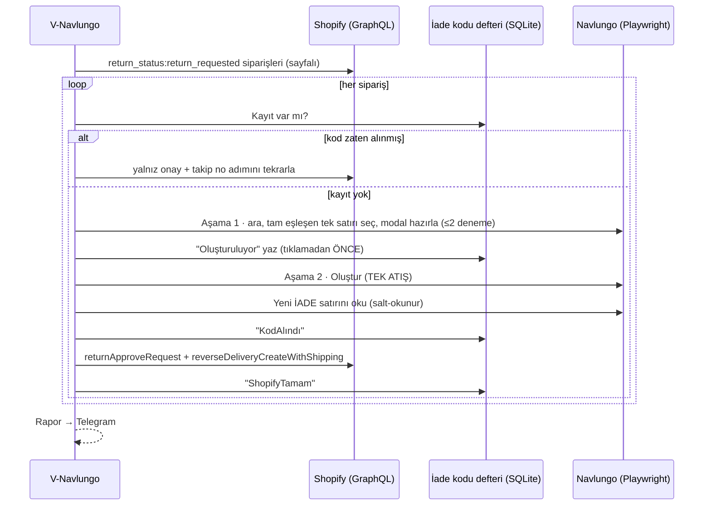
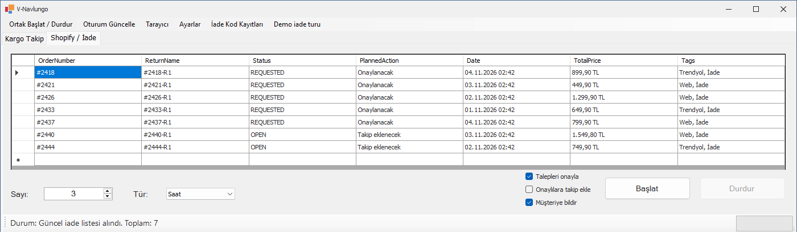
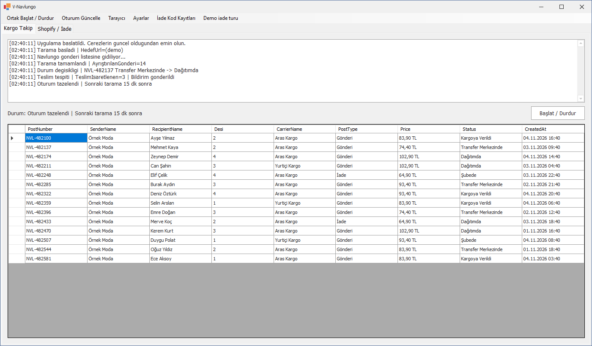
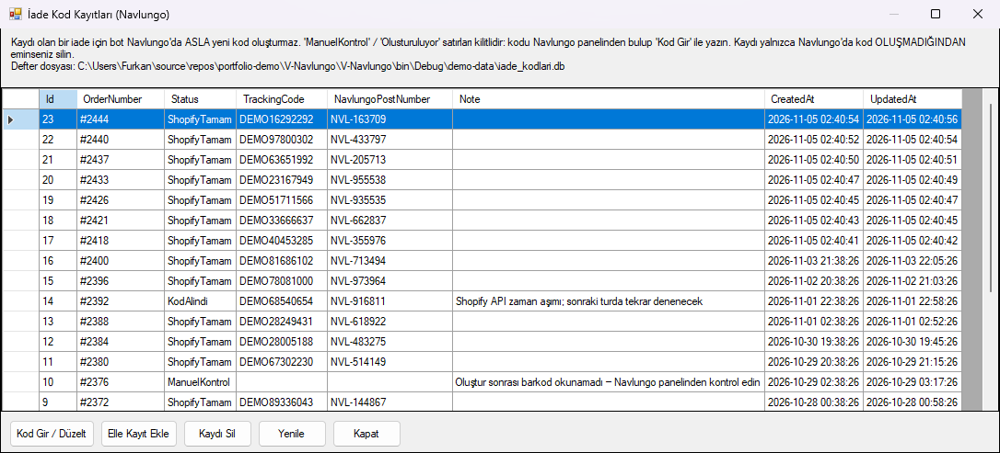

# V-Navlungo — Otomatik İade Lojistiği ve Kargo Takip Botu

**Shopify'daki iade taleplerini alıp kargo platformu Navlungo'da iade kodu üreten, iadeyi Shopify'da onaylayıp takip numarasını yazan ve iade kargolarının teslimini izleyen; para ve operasyon kaybına yol açabilecek "çift kod" hatalarına karşı katmanlı korumalarla tasarlanmış bot.**

-lightgrey)

> **30 saniyede:**
> - **Problem:** Her iade için operatör iki sistem arasında gidip geliyordu: Shopify'da talebi bul → Navlungo'da sipariş ara, iade kodu oluştur, takip numarasını kopyala → Shopify'da onayla ve numarayı yaz. Yavaş, tekrarlı ve hataya açık.
> - **Çözüm:** Shopify tarafı resmî GraphQL API ile, API'si olmayan Navlungo tarafı Playwright tarayıcı otomasyonu ile uçtan uca otomatikleştirildi; teslim takibi ve Telegram'dan uzaktan komut eklendi.
> - **Öne çıkan:** Aynı iade için iki kez kargo kodu üretilmesini imkânsız kılan **iki aşamalı oluşturma + kalıcı iade kodu defteri + tekil kilit** tasarımı.

  

<b>English summary</b>

V-Navlungo automates e-commerce return logistics between Shopify (official GraphQL Admin API via ShopifySharp) and Navlungo, a shipping platform with no public API (Playwright automation with cookie sessions). It fetches pending return requests, creates the return shipping code in Navlungo, approves the return in Shopify and attaches the tracking number, then tracks return shipments in SQLite and reports deliveries through a SignalR → Telegram bridge that also accepts remote commands. The core design goal is never creating a duplicate return code: a two-phase create (retryable preparation, single-shot creation), a persistent return-code ledger written *before* clicking "create", and a single exclusive browser lock. Source is private.

---

## Problem

İade süreci, birbirine bağlı olmayan iki sistemde elle yürüyordu. Hata maliyeti asimetrikti:

- Bir iade **atlanırsa** → müşteri bekler, şikâyet eder (geri alınabilir).
- Bir iade için **iki kez kod üretilirse** → gereksiz kargo bedeli, karışan takip numaraları, yanlış numaranın müşteriye gitmesi (geri alınması zor).

Bu yüzden hedef sadece "otomatikleştirmek" değil, **belirsizlik anında güvenli tarafta kalan** bir otomasyon kurmaktı.

## Çözüm

### Akış A — Otomatik iade onayı

### Akış B — Kargo teslim takibi
Aktif iade gönderileri periyodik olarak kazınır (AngleSharp ile tablo ayrıştırma), SQLite'a yazılır; listeden düşen gönderi "teslim edildi" olarak bildirilir.

## Mühendislik kararları

**Çift kod koruması (katmanlı savunma):**
1. **İki aşamalı oluşturma.** Hazırlık adımları güvenle tekrarlanabilir; "Oluştur"a basıldıktan sonra **hiçbir hata için tekrar oluşturulmaz** — yalnızca salt-okunur kod okuma denenir. Okunamazsa sipariş "manuel kontrol"e kilitlenir.
2. **Kalıcı iade kodu defteri.** Tıklamadan *önce* `%ProgramData%` altındaki SQLite deftere yazılır; durum makinesi: `Oluşturuluyor → KodAlındı → ShopifyTamam` / `ManuelKontrol`. Uygulama çökse bile yeniden başlatmada aynı iade için kod üretilmez. Eski sürüm verileri her açılışta tekrarsız göç ettirilir.
3. **Tam eşleşme kuralı.** Arama sonucunda sipariş numarası *tam* eşleşen ve türü iade olmayan **tek** satır yoksa işlem yapılmaz.
4. **Doğru kodu okuma.** Oluşturmadan önce mevcut iade satırlarının anlık görüntüsü alınır; sonra görüntüde olmayan ve göndericisi siparişin alıcısıyla eşleşen **tek** yeni satır okunur. Aynı anda panelden başka biri kod üretse bile yanlış numara Shopify'a yazılmaz.
5. **Tekil kilit.** Tek bir Chromium/oturum sahibi (`BrowserSessionHost`) tüm işleri `SemaphoreSlim(1,1)` ile sıraya koyar; paralel döngüler çift kod üretemez.

**Teslim çıkarımında yanlış pozitife karşı korumalar:** gönderi ancak *art arda iki taramada* görünmezse teslim sayılır; hiç satır okunamazsa ya da liste sayfa sınırına dayanırsa o turda çıkarım yapılmaz; tek turda anormal çok düşüş olursa uyarı; yeniden görünen gönderi için "DÜZELTME" bildirimi.

**Gerçek dünya dersleri:**
- Panel sürekli arka plan isteği attığı için `networkidle` beklemesi asla tamamlanmıyordu (60 sn timeout döngüleri) → `DOMContentLoaded` + kritik öğenin görünürlüğü desenine geçildi.
- Bilinçli olarak ekranlı tarayıcı; pencere CDP ile ekran dışına taşınıp Win32 ile görev çubuğu/Alt+Tab'dan gizlenir. Oturum 4 dakikada bir yoklanıp storage state diske kaydedilir.

**Uzaktan yönetim:** SignalR tabanlı ortak bildirim altyapısı üzerinden Telegram'dan *Kazımayı Başlat / İadeyi Başlat / Teslim Edilenleri Listele / Botu Durdur* komutları.

## Teknoloji yığını

| Alan | Teknolojiler |
|---|---|
| Dil / Platform | C#, .NET Framework 4.7.2, WinForms + DevExpress |
| Shopify | GraphQL Admin API, ShopifySharp |
| Tarayıcı otomasyonu | Microsoft Playwright (Chromium), CDP, Win32 API |
| HTML ayrıştırma | AngleSharp |
| Veri | SQLite |
| Bildirim / komut | SignalR istemcisi → Telegram köprüsü |

## Projenin evrimi

V-Navlungo, daha önce yazdığım [Shopifylungo](https://github.com/furkan-karapinar/Shopifylungo-showcase)'nun yeniden tasarımıdır. İlk sürüm Shopify yönetim panelini de tarayıcıyla kazıyordu; V-Navlungo'da Shopify tarafı **resmî GraphQL API'sine** taşındı, tarayıcı otomasyonu yalnızca API'si olmayan Navlungo'ya bırakıldı ve çift kod korumaları eklendi.

## Ekran görüntüleri

| | |
|---|---|
|  **İade sekmesi** — bekleyen talepler ve sonuçlar |  **Kargo takip** |
|  **İade kodu kayıtları** — `ShopifyTamam` / `KodAlindi` / `ManuelKontrol` durumları | |

> Görsellerdeki tüm sipariş, müşteri ve takip bilgileri kurgusaldır. Uygulama izole bir demo kopyasında, Navlungo ve Shopify'a bağlanmadan sahte veriyle çalıştırılmıştır; GIF'teki iade turu gerçek defter (SQLite) koduyla yazılan bir simülasyondur.

## Rolüm

Tek geliştirici: süreç analizi, iki sistemin entegrasyonu, hata senaryolarının modellenmesi, güvenlik korumaları ve operasyonel izleme.

## Kaynak kodu hakkında

Bu depo bir **vaka çalışmasıdır**; kod ticari bir işletmeye ait olduğu için paylaşılmamaktadır. Görüşmede canlı demo ve kod incelemesi yapabilirim.

📫 **İletişim:** [GitHub profilim](https://github.com/furkan-karapinar)
